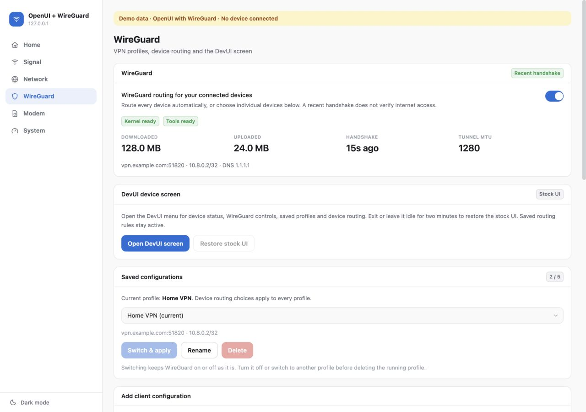
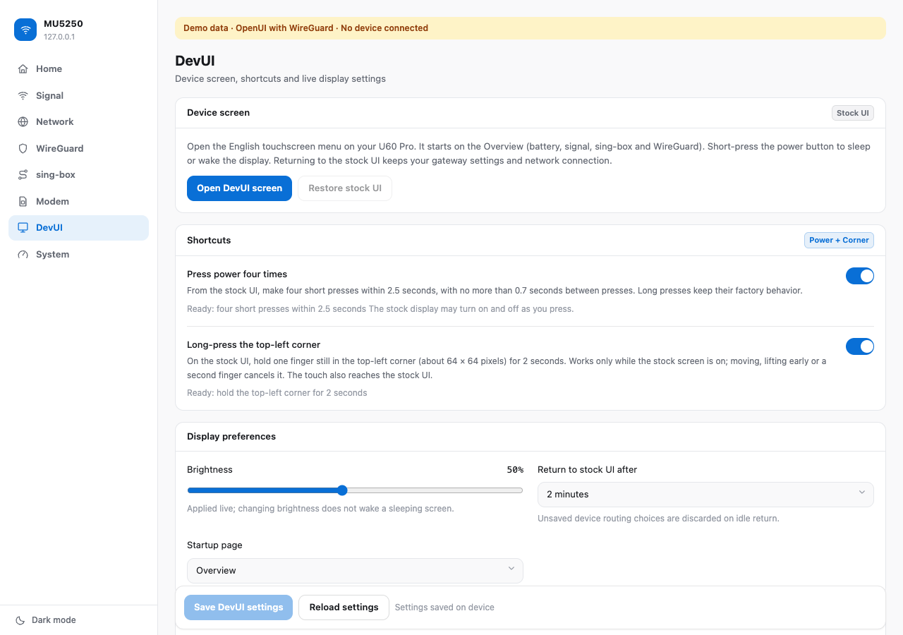
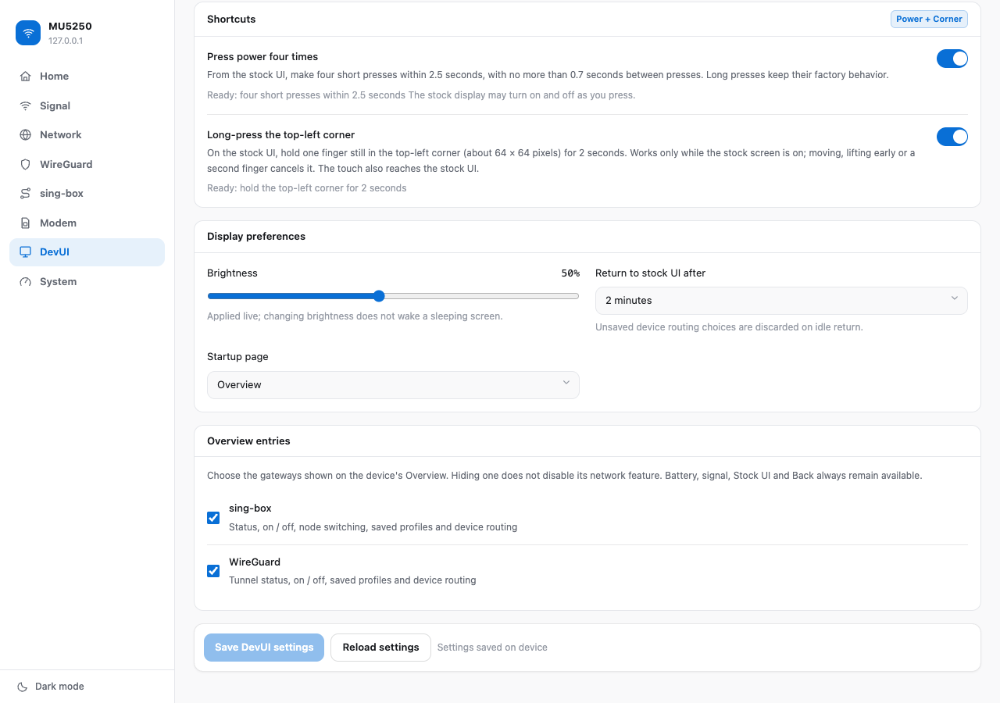
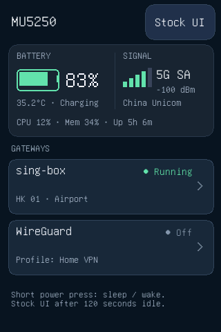
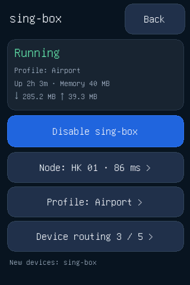
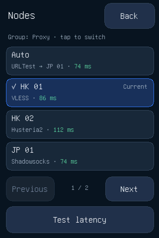
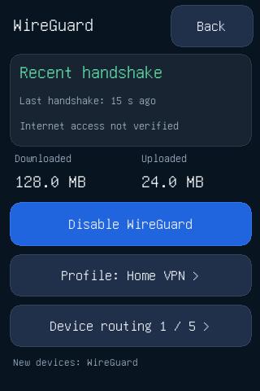
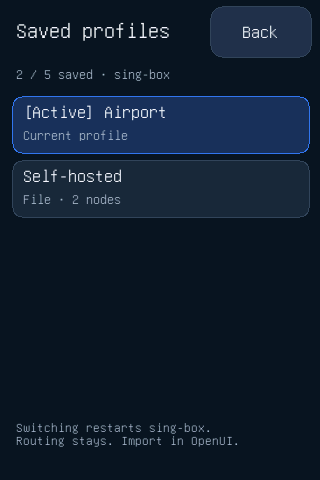
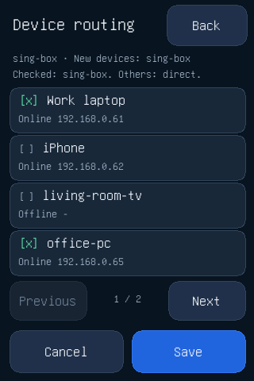

# MU5250-OpenUI-Wireguard

[English](README.md) | **简体中文**

**面向中兴 U60 Pro（MU5250）的 OpenUI + WireGuard。**

**作者：ZweiChen**

本项目是 [MU5250-OpenUI](https://github.com/dklasens/MU5250-OpenUI) 的完整分支，
集成了 WireGuard 网关、sing-box 代理网关和英文 DevUI 触摸屏菜单。
它保留 OpenUI 的 Home、Signal、Network、Modem 和 System 页面、现有登录方式、
Rust Agent 与部署流程。WireGuard 和 sing-box 在**左侧边栏各有独立入口，位于 Network 与 Modem 之间**；
侧边栏顶部标题为 **MU5250**。

| 管理服务 | 地址 |
| --- | --- |
| OpenUI Web 面板 | `http://192.168.0.1:8080/` |
| 需认证的 OpenUI API | `http://192.168.0.1:9090/` |

**快速跳转：** [设备](#设备) · [DevUI 快速上手](#devui-快速上手) · [截图](#截图) ·
[WireGuard 功能](#wireguard-功能) · [sing-box 功能](#sing-box-功能) · [路由行为](#路由行为) ·
**[安装](#安装)** · [本地演示与检查](#本地演示与检查) ·
[验证记录](#验证记录) · [文档](#文档) ·
[致谢](#致谢) · [版权与许可证](#版权与许可证)

## 设备

| **型号** | ZTE U60 Pro (MU5250) |
| ------------ | ------------------------ |
| **硬件** | `MU5250_HW1.0` |
| **固件** | `CN_ZTE_MU5250V1.0.0B31` |

| **芯片** | Qualcomm Snapdragon X75 (SDX75 / SDXPINN) |
| ----------- | ----------------------------------------- |
| **CPU** | 4x Cortex-A55 (ARMv8.2-A) @ 2.2 GHz |

以上是项目所有者提供的目标设备信息，并不代表其他型号、硬件修订或固件已经兼容。

## DevUI 快速上手

需要先安装屏幕组件并[通过验证](#验证并启用-devui-屏幕)后才能使用。

1. 在 OpenUI 侧边栏打开 **DevUI**，选择 **Open DevUI screen**。屏幕从 **Overview** 开始：
   上方是电池和蜂窝信号，下方是 sing-box 和 WireGuard 入口。点入口进入该网关的状态、开关、
   已保存配置和设备分流；sing-box 页面还可以切换节点。
2. 短按电源键让屏幕休眠或唤醒；屏幕熄灭时触摸操作会被忽略。
3. 要从原厂界面进入，请在 **Shortcuts** 中启用快捷方式并保存：
   - **Press power four times**：在 2.5 秒内连续短按四次，相邻两次间隔不超过 0.7 秒。
   - **Long-press the top-left corner**：原厂屏幕亮着时，单指按住左上角不动 2 秒。
4. 在同一网页中设置亮度、空闲返回时间（30–600 秒）、启动页（Overview、sing-box 或 WireGuard）
   和 Overview 上显示的入口。保存后，显示和入口的更改立即生效；启动页在下次打开时生效。

新安装默认关闭这两个快捷方式。电源键原厂的长按行为不变。随时可以进入原厂界面并使用返回；
退出 DevUI 不会影响 WireGuard、sing-box 和已保存的路由。详见 [DevUI 说明](docs/SCREEN.md)（英文）。

## 截图

以下是本分支的真实浏览器截图，使用**合成演示数据**。其中的端点、客户端名称、
MAC 地址和流量数值都是示例，并非真实的 VPN 测量结果，也不是私人设备信息。







下面的小屏图像由 DevUI/litehtml 渲染器使用示例数据生成，展示的是逻辑上的正向视图；
实际的帧缓冲和触摸坐标已针对 U60 的屏幕方向旋转 **180°**。

| Overview：电池、信号与网关 | sing-box |
| --- | --- |
|  |  |

| sing-box 节点 | WireGuard |
| --- | --- |
|  |  |

| 已保存配置 | 设备分流 |
| --- | --- |
|  |  |

## WireGuard 功能

- 最多保存 **5 份命名的 WireGuard 客户端配置**；可通过 OpenUI 导入 `.conf` 文件、
  切换活动配置、重命名或删除。设备分流选择在各配置之间共享，已有配置予以保留。
- 让当前和以后接入的所有局域网设备走 WireGuard，并可按 MAC 地址逐个排除；
  也可以只对勾选的设备启用隧道。
- 保留并可编辑已保存的离线设备选择，更改按批次保存。
- 显示隧道状态、最近握手、流量计数、端点和 MTU。最近握手不代表互联网一定可用。
- 配置保持私密：API 不会返回已保存的私钥或预共享密钥（PSK）。
- 在独立的 **DevUI** 侧边栏页面中打开设备的英文 320×480 触摸屏面板。从 Overview 进入其
  WireGuard 页面，无需接触密钥即可查看状态、开关隧道、切换已保存配置和更改设备选择。
- 退出、达到配置的空闲超时（默认两分钟），或监督进程检测到面板故障时，恢复原厂显示和触摸服务。
  退出面板不会影响路由。
- 检查配置修订号，网页与触摸屏的编辑不会被静默覆盖。

其余 OpenUI 功能均予保留：调制解调器信号与频段/小区控制、Wi-Fi 和路由器设置、客户端、
APN、短信、电池控制、日志和系统信息。详见[面板文档](docs/DASHBOARD.md)（英文）。

## sing-box 功能

- 导入完整的 **sing-box JSON 配置**（文件或粘贴文本），或返回 sing-box JSON 的**订阅链接**。
  最多保存 **5 份命名配置**；可在 OpenUI 中切换、重命名、删除和更新订阅。
- 在配置的每个 selector 分组中**选择节点**并测试延迟。切换立即生效，无需重启 sing-box；
  选择按配置分别记住。
- 查看运行状态、**已安装的 sing-box 版本号**、内存、流量和运行时长，并可在日志面板中查看最近的警告。
- 使用与 WireGuard 相同的按设备分流（所有设备并可逐个排除，或只对选中的设备生效）。
  配置中的出站、DNS 和路由规则予以保留；路由器把其中的入站替换为自己的入站（TCP 重定向监听端口和一个 TUN 接口）。
- 机密不外泄：API 不会返回配置内容或订阅链接；只显示订阅的主机名和节点数量。
- sing-box 与 WireGuard 互斥；启用其中一个之前，需先关闭另一个。
- 也可以在设备的 **DevUI** 触摸屏上操作：查看状态、开关、在第一个 selector 分组中切换节点、
  测试延迟、切换已保存配置和设备分流。配置内容和订阅链接不会传到屏幕上。

不转换分享链接和 Clash YAML 订阅。导入规则与恢复方法见 [sing-box 网关](docs/SINGBOX.md)（英文）。

## 路由行为

本版本管理一条**内核 WireGuard IPv4 隧道**。它需要 root 权限、现有固件中的 WireGuard 支持、
iproute2、iptables/ip6tables 和 `wg`。路由器自身的流量仍走正常的 WAN 路由。

勾选的设备走隧道，未勾选的设备保持正常上网。由于本实现不隧道化 IPv6，选中客户端的 IPv6
互联网流量以及发往路由器的 IPv6 DNS 会被阻断。IPv4 DNS 经隧道转发。本地管理仍可访问。
更改策略时，转发的局域网流量会在规则替换期间短暂暂停；更改某个设备的路由后，请重新连接该设备上的应用。

隧道策略生效期间，对端失效不会让选中的流量回落到 WAN。主动关闭 WireGuard 会恢复正常路由。
开机阶段以及原厂防火墙重载期间**不保证**继续保持这一阻断策略。
详见 [WireGuard 行为与恢复](docs/WIREGUARD.md)（英文）。

sing-box 使用同样按 MAC、仅 IPv4、故障时阻断的设备策略：被代理设备的 TCP 通过 NAT 重定向交给 sing-box，
UDP 和其他流量通过路由进入它的 TUN 接口，防火墙链、路由表和标记均独立。（该固件的原厂网桥防火墙会让 TPROXY 失效，因此不使用 TPROXY。）
sing-box 停止时，被代理的设备会被阻断，直到 Agent 将其重启；主动关闭 sing-box 会恢复正常路由。详见 [sing-box 网关](docs/SINGBOX.md)（英文）。

## 安装

安装会把 OpenUI Agent、Web 面板、`wg`、sing-box、DevUI 屏幕程序和仅密钥登录的 SSH 写入设备的
`/data` 分区，并在 `/etc/rc.local` 中加入启动行。目前**尚未发布预编译下载**，所以需要先在电脑上用本仓库
构建一份**完整离线组件包**；构建过程不会连接你的设备。然后用原生 macOS 客户端或终端安装这份组件包。
完整流程：

1. 阅读[安装前须知](#安装前须知)并[选择安装方式](#选择安装方式)。
2. [准备电脑](#准备电脑)并[构建组件包](#构建完整组件包)。
3. 使用[原生 macOS 客户端](#使用原生-macos-客户端安装)或[在终端](#在终端安装)安装。
4. [验证并启用 DevUI 屏幕](#验证并启用-devui-屏幕)。
5. [首次使用](#首次使用)，并备好[更新与恢复](#更新与恢复)的说明。

### 安装前须知

- **目标设备。** 只有中兴 U60 Pro（MU5250）、硬件 `MU5250_HW1.0`、固件 `CN_ZTE_MU5250V1.0.0B31`
  （见[设备](#设备)）经过验证。终端工具只检查设备自报为 MU5250/U60 Pro 且能读到固件版本，
  **不会**拒绝其他固件版本。请勿安装到其他型号、硬件修订或固件上。
- **请先阅读 [docs/SAFETY.md](docs/SAFETY.md)（英文）。** 安装只写入 `/data` 和 `/etc`，不触碰分区，
  除 `/etc/rc.local` 中的固定启动行外不添加任何开机钩子。解锁被锁定的设备使用的是固件自带的配置备份/恢复功能。
- **电源与连接。** 给设备充好电并保持供电。解锁会让设备重启（约 90 秒离线）。安装期间不要拔电、
  关闭终端或退出客户端：恢复快照无法防范断电或强制结束进程。对被锁定的设备做首次安装时，请通过
  **Wi-Fi** 连接；解锁期间临时使用的 USB 调试模式没有 USB 网络。
- **验证状态。** 把已有的 OpenUI 安装升级为本分支，已在 B31 测试设备上实测
  （见[验证记录](#验证记录)）。尚未用本分支的组件包在真机上完整重跑一遍“原厂全新设备解锁 + 完整安装”，
  也没有测试真实的 VPN 出口流量。请先做试运行（dry run），并保存好恢复信息。
- **不要混用上游安装器。** 上游 OpenUI 的安装包和发布版既不含 WireGuard 也不含 DevUI，并且可能覆盖它们。
  请只使用本仓库构建的组件包，或搭配它使用的原生客户端。
- **局域网内为明文 HTTP。** Web 面板和 API 没有加密。不要把端口 `8080`、`9090`、`2222` 暴露到互联网。

涉及的凭据：

| 凭据 | 用途 | 说明 |
| --- | --- | --- |
| 路由器管理密码 | 原厂 Web 界面 `http://192.168.0.1`；仅用于解锁被锁定的设备 | 即你登录原厂界面使用的密码 |
| 备份密钥后缀 | 仅用于解锁被锁定的设备 | 不包含在本仓库中；见 [docs/DEPLOYMENT.md](docs/DEPLOYMENT.md#the-backup-key-suffix)（英文） |
| OpenUI 密码（Agent 密码） | Web 面板和 API 登录 | 安装时由你设定，与路由器管理密码不同 |
| 可选的 6 位 PIN | 手机浏览器登录 Web 面板 | 通过环境变量 `ZTE_AGENT_PIN` 设置；不设置则没有 PIN |

安装会在设备上改动的内容：

| 项目 | 位置 |
| --- | --- |
| Agent | `/data/zte-agent`，开机时由 `/data/local/tmp/start_zte_agent.sh` 启动 |
| Web 面板文件 | `/data/open-u60-dashboards/<id>/`，由 `/data/www.current` 指向；由独立的 `/data/bin/dashboard-uhttpd` 在 8080 端口提供 |
| SSH（仅密钥） | `/data/bin` 中的 Dropbear，端口 `2222`；主机密钥在 `/etc/dropbear`，副本在 `/data/dropbear` |
| WireGuard 工具和 DevUI 程序 | `/data/bin/wg` 与 `/data/bin/openui-screen`（许可证位于 `/data/local/tmp/openui-screen-licenses`） |
| sing-box | `/data/bin/sing-box`（约 82 MiB；许可证声明位于 `/data/local/tmp/openui-singbox-licenses`）；状态保存在 `/data/local/tmp/openui-singbox` |
| 启动项 | `/etc/rc.local` 中固定的 `sh /data/local/tmp/start_*.sh` 行；临时的 USB 调试行会被移除 |
| 恢复快照 | `/data/local/tmp/open-u60-transactions/<id>`；安装清单 `/data/open-u60-manifest.json` |
| 固件自动升级 | 已关闭（`zwrt_zte_dm`） |

80/443 端口上的原厂 Web 界面保持不变。

### 选择安装方式

| 你的设备状态 | 怎么做 |
| --- | --- |
| 原厂固件、从未解锁：2222 端口没有 SSH，且 `adb devices` 为空 | **含解锁**的首次安装：[终端第 1–4 步](#在终端安装)或原生客户端 |
| ADB 已可用（`adb devices` 能列出设备）但未安装 OpenUI | 首次安装；`setup.sh` 会检测到 ADB 并跳过解锁 |
| 已安装上游 OpenUI（或本分支的旧版本），且 2222 端口的 SSH 可用 | **原地升级**：跳过第 2 步，使用第 3 步中的升级命令 |

在电脑上探测设备：

```sh
mkdir -p "$HOME/.ssh/known_hosts.d"
ssh -p 2222 -o BatchMode=yes -o ConnectTimeout=5 -o StrictHostKeyChecking=accept-new \
  -o UserKnownHostsFile="$HOME/.ssh/known_hosts.d/zte" root@192.168.0.1 true && echo "SSH ready"
adb devices
```

安装器工具会把设备的 SSH 主机密钥记录在同一个 `known_hosts.d/zte` 文件中。
出现 `Permission denied (publickey)` 仍然说明 OpenUI 的仅密钥 SSH 已存在，只是你的密钥不是它授权的那一把。
出现 `Connection refused` 或超时则说明没有 SSH。

两种安装方式：

| | 原生 macOS 客户端 | 终端 |
| --- | --- | --- |
| 电脑 | macOS 15+（Apple Silicon 或 Intel） | macOS 或 Linux |
| 界面 | SwiftUI 应用，中文界面 | 本仓库中的脚本 |
| 额外构建 | 客户端应用本身，来自 [MU5250-OpenUIClient](https://github.com/czwstc/MU5250-OpenUIClient) | 除组件包外无需其他构建 |
| 解锁与恢复 | 应用内置 | `setup.sh`，以及安装器打印出的恢复命令 |

### 准备电脑

使用 macOS 或 Linux，并连接设备的 Wi-Fi（或 USB-C 网络共享），确保能访问 `192.168.0.1`。
不涵盖 Windows：原来的 Windows 安装器已停止维护。
构建组件包需要联网；安装组件包时只与设备通信。

在终端安装需要：

- Python 3.9 或更新版本、`ssh` 和 `curl`；
- 首次安装和解锁还需要 `adb` 与 `openssl`。

构建组件包（只需一次）还需要：

- git，以及通过 [rustup](https://rustup.rs) 安装的 Rust 和 `aarch64-unknown-linux-musl` 目标；
- `cargo-zigbuild` 和 **Zig 0.14.1**；
- Node.js `^20.19.0 || >=22.12.0` 及 npm（不支持 Node 18）；
- 能访问 crates.io、npm 仓库、PyPI（用于 Zig）、`downloads.openwrt.org`、`github.com` 和 `unifoundry.com`。
  所有下载都会与固定的 SHA-256 比对。

在 macOS 上使用 [Homebrew](https://brew.sh)（`ssh`、`curl`、`openssl` 为 macOS 自带）：

```sh
brew install git node python android-platform-tools
# 从 https://rustup.rs 安装 Rust，然后：
rustup target add aarch64-unknown-linux-musl
cargo install --locked cargo-zigbuild
```

在 Debian/Ubuntu 上：`sudo apt-get install -y git curl openssl openssh-client python3 python3-venv android-tools-adb`，
然后同样安装 Rust。发行版自带的 Node.js 往往低于要求，请从 [nodejs.org](https://nodejs.org) 或版本管理器安装 Node.js 22 LTS。

在克隆下来的仓库里用一个一次性虚拟环境获取确切的 Zig 0.14.1（该目录已被 git 忽略），
做法与本仓库的 CI 相同：

```sh
git clone https://github.com/czwstc/MU5250-Wireguard.git
cd MU5250-Wireguard
python3 -m venv .venv-zig
.venv-zig/bin/pip install ziglang==0.14.1
export ZIG="$(.venv-zig/bin/python -c 'import pathlib,ziglang; print(pathlib.Path(ziglang.__file__).parent / "zig")')"
export PATH="$(dirname "$ZIG"):$PATH"
```

两条 `export` 只在当前终端有效；新开终端需要重新执行。检查工具：

```sh
python3 --version && node --version && rustc --version && cargo zigbuild --version && "$ZIG" version
```

`"$ZIG" version` 必须输出 `0.14.1`。

### 构建完整组件包

在仓库根目录、已导出上面的 Zig 变量的终端中运行。这一步不会连接或修改你的设备。

```sh
bash scripts/build-offline-bundle.sh
```

它会交叉编译 Agent、构建 Web 面板、从经过校验和固定的官方 OpenWrt 软件包中提取 `wg`、从校验和固定的官方静态发布包中提取 `sing-box`、
构建 DevUI 屏幕程序（拉取校验和固定的 litehtml、FreeType 和 GNU Unifont）、获取固定版本的 Dropbear 与 uhttpd 软件包，
并把 format-v2 组件包写入 `dist/install-bundle/`。首次构建需要几分钟。脚本不会覆盖已存在的目录；
想构建到别处，请把另一个**绝对路径**作为唯一参数传入。

| 组件包中的文件 | 内容 |
| --- | --- |
| `zte-agent` | aarch64 Agent |
| `dashboard-dist.tar.gz` | 构建好的 Web 面板，附带 `LICENSE`、`NOTICE` 和 `licenses/` |
| `wg` | WireGuard 命令行工具 |
| `sing-box`、`sing-box-LICENSE` | sing-box 代理（官方静态构建，GPL-3.0-or-later）及其许可证声明 |
| `openui-screen` | DevUI 屏幕程序（GPL-3.0-or-later），附带 `screen-LICENSE`、`screen-NOTICE`、`screen-THIRD-PARTY-LICENSES` |
| `dropbear.ipk`、`uhttpd.ipk` | 固定版本的 SSH 服务和独立的 Web 面板服务 |
| `sha256sums.txt`、`bundle.json` | 逐文件 SHA-256；目标设备声明与发布版本 |

校验结果（Linux 上使用 `sha256sum -c`）：

```sh
(cd dist/install-bundle && shasum -a 256 -c sha256sums.txt)
```

以后如果发布了 release，其中的 `openui-component-bundle.tar.gz` 就是同样的组件包：
先用该 release 的 `sha256sums.txt` 校验，再解压到一个空目录，用这个目录代替 `dist/install-bundle`。
release 里单独的 `zte-agent` 和 `dashboard-dist.tar.gz` 仅供 shell 工作流使用，不包含 `wg`、sing-box 和 DevUI 屏幕程序。

<details>
<summary>单独构建各个组件</summary>

需要同样的工具。输出位置：`target/aarch64-unknown-linux-musl/release/zte-agent`、
`build/dashboard-dist.tar.gz`、`build/wireguard/wg`、`build/singbox/sing-box` 和 `build/screen/openui-screen`。

```sh
cargo zigbuild --locked --release -p zte-agent --target aarch64-unknown-linux-musl
cd web-app
npm ci
npm run build
cd ..
mkdir -p build
tar czf build/dashboard-dist.tar.gz -C web-app/dist .
python3 scripts/prepare-wireguard.py --output build/wireguard/wg
python3 scripts/prepare-singbox.py --output build/singbox/sing-box
ZIG=/path/to/zig sh screen/build.sh
```

`wg` 准备脚本会下载经过校验和固定的官方 OpenWrt 软件包，只提取其中的命令行工具。
sing-box 准备脚本会下载固定版本的官方发布包，只提取其中的二进制文件。
屏幕构建会获取校验和固定的 litehtml、FreeType 和 GNU Unifont。
这些命令都不会连接或修改你的设备。下面的命令中，可以用这些路径代替组件包里的文件。

</details>

### 使用原生 macOS 客户端安装

桌面安装器位于独立项目 [MU5250-OpenUIClient](https://github.com/czwstc/MU5250-OpenUIClient)
（SwiftUI/AppKit，macOS 15+，支持 Apple Silicon 和 Intel，中文界面）。它会检测设备、做预检，
用与终端工具相同的快照和回滚事务进行安装，并能恢复被中断的安装。运行时无需 Rust、Node.js，也无需另外安装 ADB。

1. 从该仓库构建应用（`bash scripts/build-macos.sh arm64`，Intel 用 `x86_64`；详见其 README）。
   目前没有经过公证的下载包：构建结果只做本地签名，在线更新已禁用。
2. 连接设备并打开应用。出现提示时，允许 macOS 的**本地网络**访问。
3. 打开**维护 → 安装与维护**，选择**已解压的组件包目录**（`dist/install-bundle`）。
   客户端只接受完整的 format-v2 本地目录；不含 WireGuard 和 DevUI 的上游或旧版组件包会被拒绝。
   `sing-box` 文件是在当前客户端版本之后才加入组件包的；如果客户端拒绝该组件包或没有安装 sing-box，请改用终端安装。
4. 设置 OpenUI 密码和 PIN 选项。已有安装可以保留当前凭据。
5. 运行预检，然后安装、更新或修复。对被锁定的设备，客户端会要求输入路由器管理密码和备份密钥后缀，
   准备并校验备份，并在恢复和重启之前请你确认。
6. 之后运行[屏幕验证](#验证并启用-devui-屏幕)。客户端使用它自己的 SSH 身份
   `~/Library/Application Support/open-u60-pro/ssh/id_ed25519`，请把这个路径作为 `--ssh-key` 传入。

该应用已在 B31 测试设备上验证过对已有 OpenUI 安装的升级；尚未通过它做过原厂全新安装。
如果重新构建后应用提示本地网络访问被禁止，请在“系统设置 → 隐私与安全性 → 本地网络”中把该应用的开关关闭再打开，然后重启应用。
更多细节见客户端的 README。

### 在终端安装

所有命令都在仓库根目录运行，组件包位于上面构建出的 `dist/install-bundle`。请在隐藏输入提示处输入密码；
不要把密码写在命令行参数里（同一台电脑上的其他用户能看到），也不要写进会被提交的文件。
下面的 `ssh` 示例使用你默认的 SSH 身份（`~/.ssh/id_ed25519`）；如果设备授权的是另一把密钥，请加上 `-i <密钥>`。

#### 第 1 步 检查设备状态

用[选择安装方式](#选择安装方式)中的探测命令判断：需要执行第 2 步（首次安装），还是可以直接跳到第 3 步（原地升级）。

#### 第 2 步 使用 setup.sh 首次安装

先做试运行。对被锁定的设备，它在准备并检查完解锁备份后停止；对已解锁的设备，它检查设备身份和存储空间。
不会向设备写入任何内容，提问与下面所述的正式运行相同：

```sh
ZTE_DRY_RUN=1 ZTE_BUNDLE_PATH="$PWD/dist/install-bundle" bash setup.sh
```

然后正式运行。只有想要手机 PIN 时才加 `ZTE_AGENT_PIN=<6 位数字>`；设备的局域网地址不是 `192.168.0.1` 时加
`ZTE_GATEWAY=<地址>`：

```sh
ZTE_BUNDLE_PATH="$PWD/dist/install-bundle" bash setup.sh
```

会询问什么、会发生什么：

1. **Router admin password**（路由器管理密码）和 **Agent API password**（Agent 密码），均为隐藏输入。
   Agent 密码就是之后的 OpenUI 登录密码。路由器密码只在解锁时使用，但提示要求输入非空值。
2. **How would you like to get the zte-agent binary?** 输入 **`1`**。因为设置了 `ZTE_BUNDLE_PATH`，
   它会从你本地的组件包读取 Agent 以及 SSH 和 Web 服务软件包、校验它们的哈希，不下载任何东西。
   没设置 `ZTE_BUNDLE_PATH` 时**不要**选 `1`：脚本会去获取上游 MU5250-OpenUI 项目发布的 Agent，其中没有 WireGuard 和 DevUI。
   选项 `2` 用 `aarch64-linux-musl-gcc` 从源码构建 Agent（macOS 上需要 `brew install filosottile/musl-cross/musl-cross`，
   非常慢）；由于组件包本来就由本仓库源码构建，没有必要这么做。
3. 缺少的主机工具会被列出，经你确认后才会安装。
4. 如果 SSH 和 ADB 都连不上，脚本会认为设备被锁定。你输入**备份密钥后缀**（隐藏输入）；
   脚本先对 `scripts/zunlock.py` 做一次 dry run，再进行真正的解锁，上传前会要求你确认。
   设备会恢复配置并**重启**（60–90 秒），脚本最多等待三分钟让 ADB 出现。
5. 安装 Agent，配置并验证仅密钥登录的 SSH，设置独立的 Web 面板服务，关闭固件自动升级，并移除临时的 USB 调试启动行。
   任何一步失败，都会恢复到改动之前的快照。
6. 最后输出 `Agent and key-only SSH verified.`

SSH 密钥：安装器会在设备上授权 `~/.ssh/id_ed25519`。如果你没有这把密钥，它会创建一把**空口令**的密钥；
请妥善保管，或者事先自己生成一把。

#### 第 3 步 安装 Web 面板、WireGuard 工具和 DevUI

使用第 2 步中的 SSH 密钥（除非你用了自己的密钥，否则就是 `~/.ssh/id_ed25519`）。
先用 `--dry-run` 试运行，确认结果后，去掉它再运行同一条命令。

首次安装之后，Agent 已经就位：

```sh
python3 scripts/deploy-components.py \
  --gateway 192.168.0.1 \
  --ssh-key "$HOME/.ssh/id_ed25519" \
  --dashboard dist/install-bundle/dashboard-dist.tar.gz \
  --wireguard-tools dist/install-bundle/wg \
  --singbox-binary dist/install-bundle/sing-box \
  --screen dist/install-bundle/openui-screen \
  --dry-run
```

要**升级已有安装**，请加上 Agent。这是在更新 OpenUI 本身，不会另外启动一个管理程序。Agent 会用你提供的凭据重新安装，
所以请在提示处输入**现有的** Agent 密码，并先导出现有的 PIN。省略原本使用的 PIN 会关闭 PIN 登录：

```sh
printf 'Existing PIN (empty if none): '; read -rs ZTE_AGENT_PIN; echo; export ZTE_AGENT_PIN
python3 scripts/deploy-components.py \
  --gateway 192.168.0.1 \
  --ssh-key '/path/to/the/key/used/for/the/original/install' \
  --agent dist/install-bundle/zte-agent \
  --dashboard dist/install-bundle/dashboard-dist.tar.gz \
  --wireguard-tools dist/install-bundle/wg \
  --singbox-binary dist/install-bundle/sing-box \
  --screen dist/install-bundle/openui-screen \
  --dry-run
```

试运行成功会输出 `Dry run passed: identity, local artifacts and storage checked; no deployment writes.`
正式运行会先输出 `Verified … (firmware)`，然后是 `Recovery command for this device: …`，最后以
`Deployment verified. Recovery snapshot retained on the modem.` 结束。**请把这条恢复命令保存到安全的地方**
（见[更新与恢复](#更新与恢复)）。注意事项：

- 替换正在运行的屏幕程序之前，先恢复原厂屏幕：在 DevUI 页面点 **Restore stock UI**，
  或运行 `ssh -p 2222 root@192.168.0.1 /data/bin/openui-screen --restore`。
- 如果试运行提示缺少 Web 面板服务（较旧的安装会这样），运行一次 `bash scripts/zharden.sh` 后重试。
- 存在未完成的部署时，新的部署会被阻止，直到它被恢复。
- sing-box 二进制约 82 MiB，传输可能需要几分钟。正在运行的 sing-box 会继续使用旧的二进制，
  直到下次启动（在 sing-box 页面关闭再打开即可）。
- 只更新单个组件时，`./deploy-dashboard.sh` 只重新构建并部署 Web 面板（需要 Node.js），
  `./deploy.sh` 只重新构建并部署 Agent（需要 `aarch64-linux-musl-gcc`）。二者都接受相同的附加参数，例如 `--dry-run` 和 `--ssh-key`。

#### 第 4 步 重启一次（首次安装）

解锁之后，设备仍处于临时的 USB 调试模式。准备好后，从 Web 面板（**System → Settings → Service controls → Reboot**）
重启设备：它会回到正常的 USB 网络共享，并且这次重启能确认 Agent、Web 面板（`:8080`）和 SSH（`:2222`）会自行启动。

### 验证并启用 DevUI 屏幕

安装屏幕程序后，它特意保持锁定。在通过受监督的恢复检查之前，DevUI 页面会显示
*The screen component must be installed and pass device recovery verification before it can open.*，
两个原厂界面快捷方式也保持关闭。运行：

```sh
python3 scripts/verify-screen.py --gateway 192.168.0.1 --port 2222 \
  --ssh-key "$HOME/.ssh/id_ed25519"
```

- 它在内存中从设备读取现有的 Agent 登录信息，不会打印出来。
- 它会临时接管物理屏幕几分钟（包含一次两分钟的空闲测试），检查背光关/开、无需触摸的启动、崩溃和面板卡死后的恢复、
  网页打开/关闭以及默认的 120 秒空闲返回。期间请不要触摸屏幕或电源键。它不会更改 WireGuard 配置或网络规则。
- 请在默认的 120 秒空闲设置下运行；如果测试时无人值守，请关闭原厂界面快捷方式。
- 成功后，网页入口和快捷方式才可用。失败则恢复原厂界面并删除验证标记。
- 每次更新屏幕程序后都要重新运行：新的二进制文件会使标记失效。

更多细节和手动恢复方法见 [docs/SCREEN.md](docs/SCREEN.md)（英文）。

### 首次使用

1. 在连接到该设备网络的设备上打开 `http://192.168.0.1:8080/`，用你的 OpenUI 密码登录。
   6 位 PIN 只能在手机浏览器上使用，并且只有设置过才有。
2. 在侧边栏打开 **WireGuard**（位于 Network 与 Modem 之间）。全新安装后它是关闭的。
   在 **Add client configuration** 下导入单 Peer 的 IPv4 `.conf`，起个名字，点 **Save new profile**，
   选择设备，然后启用隧道。最近握手不能证明互联网可用。请先阅读
   [WireGuard 行为与恢复](docs/WIREGUARD.md)（英文）。
3. 想改用代理时，打开 **sing-box**（位于 WireGuard 下方；需先关闭 WireGuard）。在 **Add configuration** 下
   导入 sing-box JSON 文件或订阅，选择设备并启用，然后在 **Node selection** 中选择节点。请先阅读
   [sing-box 网关](docs/SINGBOX.md)（英文）。
4. 打开 **DevUI** 使用触摸屏菜单（见 [DevUI 快速上手](#devui-快速上手)）。
5. 可选的 SSH 检查：

   ```sh
   ssh -p 2222 -i "$HOME/.ssh/id_ed25519" root@192.168.0.1 \
     'test -d /sys/module/wireguard && echo kernel-wireguard-present; /data/bin/wg --version; test -c /dev/net/tun && echo tun-present; /data/bin/sing-box version | head -n 1'
   ```

### 更新与恢复

- **更新。** 拉取新源码，把组件包构建到一个新目录，然后先带 `--dry-run` 运行第 3 步中的升级命令。
  保持原来的 Agent 密码和 PIN，先恢复原厂屏幕，更新后重新运行屏幕验证。Agent 和 Web 面板要一起更新。
- **回滚。** 部署失败会自动恢复快照（输出 `Previous installation restored.`）。如果连接中断了，
  请重新连接同一台设备，并在设备上运行之前打印出的恢复命令：

  ```sh
  ssh -p 2222 -i "$HOME/.ssh/id_ed25519" root@192.168.0.1 '<之前打印出的恢复命令>'
  ```

  它的形式是 `sh /data/local/tmp/open-u60-transaction.sh restore <id> <fingerprint>`。成功的快照会保留在设备上，
  所以也可以用它回到某次部署之前的状态。快照涵盖 Agent、Web 面板指针、启动脚本、SSH 与 Web 服务二进制、`rc.local`、`wg`、sing-box 和屏幕程序；
  不包含已保存的 WireGuard 或 sing-box 配置和 DevUI 设置。没有单独的卸载程序。原生客户端可以在界面中恢复被中断安装的快照。
- **屏幕或隧道卡住。** 用 `ssh -p 2222 root@192.168.0.1 /data/bin/openui-screen --restore` 恢复显示。
  在 Web 面板中关闭隧道或 sing-box 即可恢复正常路由；见
  [docs/WIREGUARD.md](docs/WIREGUARD.md#ownership-and-recovery) 和
  [docs/SINGBOX.md](docs/SINGBOX.md#ownership-and-recovery)（英文）。
- **固件升级之后。** 安装器会关闭固件自动升级。固件升级会清掉 `rc.local` 中的启动行，服务因此不再随开机启动，
  而设备本身仍能正常启动；请按上面的步骤重新安装。可用
  `ssh -p 2222 root@192.168.0.1 'uci get zwrt_zte_dm.dm_update.dm_update_mode'` 确认自动升级仍是关闭的（输出 `0`）。
  详见 [docs/DEPLOYMENT.md](docs/DEPLOYMENT.md)（英文）。
- **保管好文件。** 终端流程中，原始的加密解锁备份保存在 `~/.local/share/open-u60-pro/recovery`。
  不要删除它们，也不要提交凭据、备份、密钥或 `.conf` 文件。

### 常见问题

| 现象或提示 | 处理方法 |
| --- | --- |
| `Unsupported Node.js …; dashboard builds require ^20.19.0 \|\| >=22.12.0`，或在旧版 Node.js 上 Web 面板构建失败 | 安装 Node.js 22 LTS（20.19+ 也可以），用 `node --version` 确认，然后重新构建。 |
| `Choose a new output directory; an existing bundle will not be overwritten.` | 删除或重命名 `dist/install-bundle`，或者给脚本传一个新的绝对路径。 |
| `… checksum mismatch` 或 `… package integrity check failed` | 固定版本的下载内容变了或已损坏（代理、认证门户等）。换个干净的网络重试，不要绕过校验。 |
| `Expected a root shell on the aarch64 U60 Pro` 或 `Device identity or firmware could not be verified as a U60 Pro` | 连接没有以 root 身份到达目标设备。检查 `--gateway`、`--ssh-key` 和你的网络。 |
| `Multiple ADB devices connected; select one with --adb-serial` | 拔掉其他 Android 设备，或传入 `--adb-serial SERIAL`。 |
| `An unfinished deployment exists. Recover it before starting another installation.` | 在设备上运行保存的恢复命令，或使用客户端的恢复功能。 |
| `Insufficient storage for deployment and rollback` | 释放设备 `/data` 的空间。`/data/local/tmp/open-u60-transactions/` 中的旧快照会占用空间；删除前请先保存需要的恢复数据。 |
| 2222 端口出现 `Permission denied (publickey)` | SSH 已安装，但你的密钥没有被授权。请使用最初安装时的密钥（`-i` 或 `--ssh-key`）。 |
| `REMOTE HOST IDENTIFICATION HAS CHANGED` | 设备的 SSH 主机密钥被重新生成了（例如恢复出厂设置）。确认确实是你的设备后执行：`ssh-keygen -R '[192.168.0.1]:2222' -f ~/.ssh/known_hosts.d/zte`。 |
| 8080 端口的 Web 面板打不开 | `ssh -p 2222 root@192.168.0.1 'sh /data/local/tmp/start_dashboard.sh; cat /tmp/dashboard-uhttpd.log; /usr/bin/curl -v http://127.0.0.1:8080/'` |
| DevUI 页面提示 *The screen component must be installed and pass device recovery verification before it can open.* | 运行[屏幕验证](#验证并启用-devui-屏幕)。 |
| WireGuard 页面提示 `Kernel WireGuard or /data/bin/wg is unavailable` | 检查 `/data/bin/wg --version` 以及 `/sys/module/wireguard` 是否存在。该固件没有内核 WireGuard 时，隧道无法运行。 |
| sing-box 页面提示 `sing-box is not installed: deploy /data/bin/sing-box` | 用 `--singbox-binary` 部署它（第 3 步）。 |
| sing-box 页面提示 `Kernel TUN (/dev/net/tun) or iptables REDIRECT support is unavailable` | 该固件无法运行 sing-box 网关；可通过 SSH 执行 `ls -l /dev/net/tun` 和 `grep REDIRECT /proc/net/ip_tables_targets` 确认。 |
| sing-box 页面提示 `sing-box rejected the configuration: …` | 配置与 sing-box 1.14 不兼容（例如旧式 `dns`/`block` 出站）或引用了缺失的内容。按提示修改后重新导入。 |
| sing-box 页面提示 `TLS verification failed for the subscription server` 或其他下载错误 | 路由器无法用自己的连接获取该链接。请在电脑上下载 JSON，再以文件方式导入。 |
| `Turn WireGuard off before enabling sing-box`（或反过来） | 同一时间只能有一个网关为设备分流。 |
| 固件升级后服务消失 | 重新安装；见[更新与恢复](#更新与恢复)。 |

## 本地演示与检查

在两个终端中分别运行：

```sh
python3 web-app/tools/mock_agent.py --port 19090 --wireguard-demo
```

```sh
cd web-app
npm ci
npm run demo
```

把 `--wireguard-demo` 换成 `--singbox-demo`，即可用示例配置和节点预览 sing-box 页面。
打开 Vite 给出的地址，用任意非空密码登录演示环境。两个开发服务器都应只监听本机回环地址。
模拟 Agent 的数据只保存在内存中，不会连接设备。生产构建使用设备上正常的 `9090` API，
不包含演示横幅和演示 API 地址。

```sh
cargo test --locked -p zte-agent -p process-runner
python3 -m unittest discover -s tests -v
python3 scripts/check-api-contract.py
cd web-app
npm run build
npm run lint
npm test
cd ..
sh screen/build.sh --preview
```

## 验证记录

Agent、Web 面板和 DevUI 屏幕已于 2026-09-14 部署到目标 B31 设备。检查确认了构件哈希一致，
登录设置、已保存的配置和设备分流均未改变。真机屏幕测试通过了短时 Atomic 接管、崩溃恢复、
子进程卡死恢复、网页重复打开、网页关闭，以及默认 120 秒空闲后返回原厂界面。
本地套接字返回了两份已保存的配置、三台设备和一份系统概览。WireGuard 保持关闭；这次更新没有测试真实的 VPN 出口流量。
本地 Rust、Python 和前端检查全部通过，DevUI 渲染以及针对配置切换、设备分页、草稿和禁用状态的真实 HTML 点击测试也通过。
部署恢复快照保留在设备上。

DevUI 设置更新在同一台 B31 设备上验证过：实时亮度调节、修订冲突、私有设置存储、可配置的 30 秒空闲返回，
以及默认的 120 秒恢复路径均通过。设备所有者确认，**连续短按电源键四次即可打开 DevUI，
且无需触摸屏幕，第一帧画面立即出现**。测试设备上已启用该快捷方式；新安装默认仍为关闭。
项目文档以英文为主，另提供中文 README（本文件）；英文版见 [README.md](README.md)。

sing-box 网关（TCP 经 REDIRECT，UDP 经 TUN）已于 2026-10-18 在 B31 设备上，在开启网桥防火墙的真实网桥后面
通过隔离网络命名空间测试（`tests/singbox-netns.sh`，sing-box 1.14.3）：TCP 经 REDIRECT 和 SOCKS 跳转、
DNS 及其他 UDP 经 TUN、sing-box 停止时阻断、被排除设备直连以及完整清理均通过，设备自身的防火墙和路由未被改动。
用一台 Wi-Fi 客户端和真实配置做的实机检查也已通过。早先的 TPROXY 方案因在设备网桥上失效而放弃。

DevUI 改版（带电池和信号的 Overview、sing-box 页面、左上角长按）已于 2026-10-19 部署到同一台设备。
`verify-screen.py` 和 `verify-devui-settings.py` 均通过，已保存的 WireGuard 配置未改变，
原有的 DevUI 设置已迁移为 Overview，四连按快捷方式保持启用。设备所有者确认，**左上角长按 2 秒和连续短按电源键四次
都能打开 DevUI**，Overview、sing-box 切换节点和 WireGuard 各页面均正常。详见 [DevUI 说明](docs/SCREEN.md)（英文）。

## 文档

以下文档目前为英文：

- [部署：解锁、安装、更新](docs/DEPLOYMENT.md)和[安全规则](docs/SAFETY.md)
- [WireGuard 行为与恢复](docs/WIREGUARD.md)、[sing-box 网关](docs/SINGBOX.md)和 [DevUI 屏幕](docs/SCREEN.md)
- [Web 面板](docs/DASHBOARD.md)、[Agent 与 API](docs/AGENT.md)和 [QoS API](docs/API-QOS.md)
  （原生客户端使用的、需认证的真实承载数据）
- 原生 macOS 安装器与管理客户端：
  [MU5250-OpenUIClient](https://github.com/czwstc/MU5250-OpenUIClient)（中文）

## 致谢

- [dklasens/MU5250-OpenUI](https://github.com/dklasens/MU5250-OpenUI) — 本分支使用的
  OpenUI 后端、Web 面板、安装器和部署基础。
- [jesther-ai/open-u60-pro](https://github.com/jesther-ai/open-u60-pro) — OpenUI 所基于的
  原始 open U60 项目及设备接入工作。
- [amenekowo/mu5250_tweaking](https://github.com/amenekowo/mu5250_tweaking) — MU5250
  硬件研究，以及触摸屏组件所用的 Atomic DRM 示例。

- [u60pro-devui by 33333s](https://github.com/33333s/u60pro-devui) — DevUI 菜单使用的
  HTML/CSS RGB565 渲染器。我们保留自己的 Atomic 显示、触摸处理、监督进程和 OpenUI Agent，
  而不使用它的设备服务脚本。
- [scoltzero/u60pro-devui-remix](https://github.com/scoltzero/u60pro-devui-remix) —
  把 VPN 控制放进设备菜单的参考；其 UFI-TOOLS WireGuard 后端未被使用。
- [SagerNet/sing-box](https://github.com/SagerNet/sing-box) — sing-box 页面运行的通用代理平台（未经修改）。
  本项目与其无隶属关系。

同时感谢 litehtml、FreeType、GNU Unifont 和 WireGuard 项目。原作者和许可证声明均予保留；
本仓库不包含中兴固件、私人配置或原始参考压缩包。

## 版权与许可证

Copyright © 2026 **ZweiChen**，涵盖本分支新增的部分。
已有贡献保留其原作者的版权。

| 组件 | 许可证 |
| --- | --- |
| OpenUI Agent、Web 面板和通用工具 | [MIT](LICENSE)，保留 David Klasens 和 Jesther Silvestre 的声明 |
| 独立的原生屏幕程序和改编的 DRM 代码 | [GPL-3.0-or-later](screen/LICENSE) |
| 内嵌的 GNU Unifont OTF | [SIL Open Font License 1.1](screen/FONT-LICENSE) |
| 组件包中的 sing-box 二进制 | [GPL-3.0-or-later](licenses/sing-box-LICENSE.txt)，未经修改的上游发布版 |
| 依赖项和下载的工具 | 各自上游的许可证 |

参见 [NOTICE](NOTICE)、[屏幕组件声明](screen/NOTICE)和[保留的上游许可证](licenses/)。
根目录的 MIT 许可证不会重新授权 GPL 屏幕代码或第三方字体。分发 GPL 屏幕可执行文件时，
需要同时提供对应的源码和适用的声明；屏幕源码和构建脚本已包含在本仓库中。
完整组件包包含 Agent、Web 面板、`wg`、sing-box、受监督的 DevUI 程序、固定版本的服务依赖、许可证和逐文件 SHA-256。
